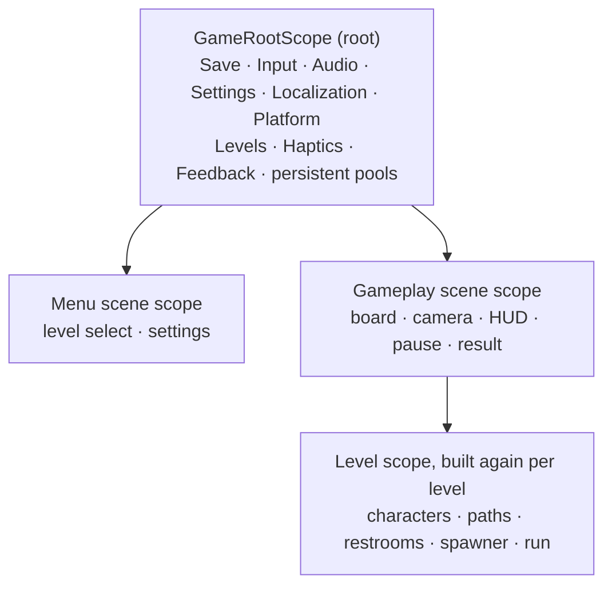
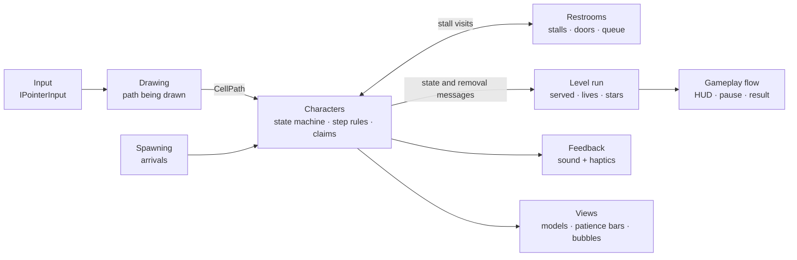

# HoldIt

[Türkçe](README.tr.md)

*Draw their path. Mind the queue. Don't let anyone wet themselves.*

HoldIt is a portrait Android puzzle seen from above. Men and women keep arriving at a restroom building, each with a
patience bar that never stops filling. You drag a path from a visitor, square by square, to the right door. The wrong
door, a passage too narrow for a heavy visitor or a square somebody stands on stops them where they are. When the bar is
full there is an accident, and three accidents end the level.

It is a small, finished game built as a portfolio piece: a real Unity project with clean rules, tests and a framework under
it, rather than a prototype.

## How to play

- **Draw a path.** Press on a visitor and drag across the board. The path grows one square at a time and shows where the
  visitor can stop; let go and they walk it.
- **Doors are gendered.** A man at a woman's door is turned back with a speech bubble and stays put; draw again.
- **Bodies matter.** Thin, Normal and Fat visitors walk at different speeds, and Fat visitors do not fit through narrow
  passages.
- **Stalls fill up.** A visitor takes a free stall and the lamp turns red. If every stall is taken, they wait at the door
  and block that square, so the next visitor in line has to be routed around them.
- **Patience runs out.** The bar above each head turns from green to red and the visitor starts to shake. An accident leaves
  a puddle and costs one of your three lives.
- **Stars** are the lives you have left when the last visitor is served or lost. There are 30 levels, each with its own map.

## Screenshots

*Main menu, level select, a level in progress, the result screen and settings.*

## Download

An Android APK (Android 7.1 or newer, ARM64) is attached to the project's
[GitHub Releases](https://github.com/ramazantoy/HoldIt/releases) once a release is published. It is signed with a debug key,
so install it by allowing installs from unknown sources; Play Protect may warn about an unknown developer. The game is not
on any store. The APK is not kept in the repository; it is a Release build of version 0.1.0 and can be rebuilt from source
(see below).

## Status

Playable from the first level to the last, in English and Turkish, with sound, music and vibration (which can be switched
off in Settings). What is still rough, so nobody has to find it out:

- The characters are placeholder primitives (six variants: man and woman, thin, normal and fat). The real models are not in
  yet, and neither are the final stall parts of the environment kit.
- It has been played on one Android phone. Other devices, the vibration strengths and the feel of the animations on a phone
  are still to be checked.
- The difficulty curve is tuned by a simulation with a reference player, not yet against real play.

## How it is built

Unity 6000.3.27f2 (6.3 LTS) with the Universal Render Pipeline, a custom toon shader and an environment kit modelled in
Blender. Code uses VContainer, MessagePipe, UniTask, PrimeTween and the Input System.

The rules are plain C# with no Unity types where that is possible: the grid, the path being drawn, the characters' state
machine, stalls and queues, patience, spawning and the run itself. MonoBehaviours only draw them. Every rule class has
EditMode tests (more than 650 in the game assembly alone), and each new test file was checked by breaking the code once and
seeing the test fail. Gameplay code knows input only through `IPointerInput`, and features reach each other through small
interfaces and MessagePipe messages.

Levels are `ScriptableObject`s, each with its own map; a generator and a map tool in the Editor produce the 30 levels, and
a simulation with a reference player tunes how many visitors come and how fast. All tunable numbers live in config assets.

Underneath is `Assets/Framework/`, a small framework (scopes, game states, scene loading, saving, input modes, audio, pools,
settings, localization, platform services and a checked build pipeline), documented module by module in
[`Assets/Framework/Documentation~`](Assets/Framework/Documentation~/Core.md).

## Project layout

| Path | What is there |
|---|---|
| `Assets/Game/` | The game: `Game` assembly, namespace `HoldIt`, one folder per feature (`Board`, `Paths`, `Characters`, `Restrooms`, `Spawning`, `Levels`, `Gameplay`, `UI`, ...) |
| `Assets/Game/Tests/` | EditMode tests of the rule classes (`Game.Tests`) |
| `Assets/Framework/` | The framework (`AF.*`), with its own tests and [documentation](Assets/Framework/Documentation~/Core.md) |
| `.claude/` | Decision log (`decisions/`, one file per area) and the rules the work followed |
| `CLAUDE.md` | The working rules for Claude Code on this project |

## Building from source

1. Open the project with Unity **6000.3.27f2** and accept the missing-signature dialog for the OpenUPM packages.
2. For Android, install Android Build Support (SDK, NDK, OpenJDK) and switch the platform in **File > Build Profiles**.
3. Run the tests from **Window > General > Test Runner** (EditMode) and **AF > Validate All**.
4. **AF > Build > Release** builds the active platform into `Builds/<Platform>/Release/`; it refuses to build if a check fails.

## Credits and licenses

The code is under the [MIT license](LICENSE). Third-party assets and packages keep their own licenses, and each asset folder holds the license
text next to the files.

| Asset | Author and source | License |
|---|---|---|
| UI sounds | [Interface Sounds](https://kenney.nl/assets/interface-sounds), Kenney | CC0 |
| Level won and lost jingles | [Music Jingles](https://kenney.nl/assets/music-jingles), Kenney | CC0 |
| Knock, door, flush and splash sounds | ["100 CC0 SFX"](https://opengameart.org/content/100-cc0-sfx), OpenGameArt | CC0 |
| Menu music | ["Jump"](https://opengameart.org/content/jump), ThePixel, OpenGameArt | CC0 |
| Game music | ["Free Fall"](https://opengameart.org/content/free-fall), Tad, OpenGameArt | CC0 |
| Font Baloo 2 | [The Baloo 2 Project Authors](https://github.com/EkType/Baloo2) | SIL OFL 1.1 (`Assets/Game/UI/Fonts/OFL.txt`) |
| Font Liberation Sans (TextMesh Pro default) | Red Hat, Inc.; digitized data by Google | SIL OFL 1.1 |
| Environment kit, UI sprites, characters, splash video | Own work | MIT, like the code |
| Screenshots and GIFs | Recorded by the author from the running game in the Unity Editor; the GIFs play at double speed | Own work, MIT like the code; the fonts and art in them keep the licenses above |
| VContainer, UniTask, MessagePipe | [hadashiA](https://github.com/hadashiA/VContainer) and [Cysharp](https://github.com/Cysharp) | MIT |
| PrimeTween | [Kyrylo Kuzyk](https://github.com/KyryloKuzyk/PrimeTween) | PrimeTween license; installed from npm and not copied into this repository, as its terms require |
| Input System, Localization, URP and other Unity packages; Newtonsoft Json | Unity Technologies; James Newton-King | Unity package terms (installed through the Package Manager); MIT |

## Authorship

Architecture, decisions and review by Ramazan Toy. Much of the code was written with Claude Code under that direction; those
commits carry a Co-Authored-By line. `CLAUDE.md` and `.claude/` hold the rules and the decision log the work followed.
