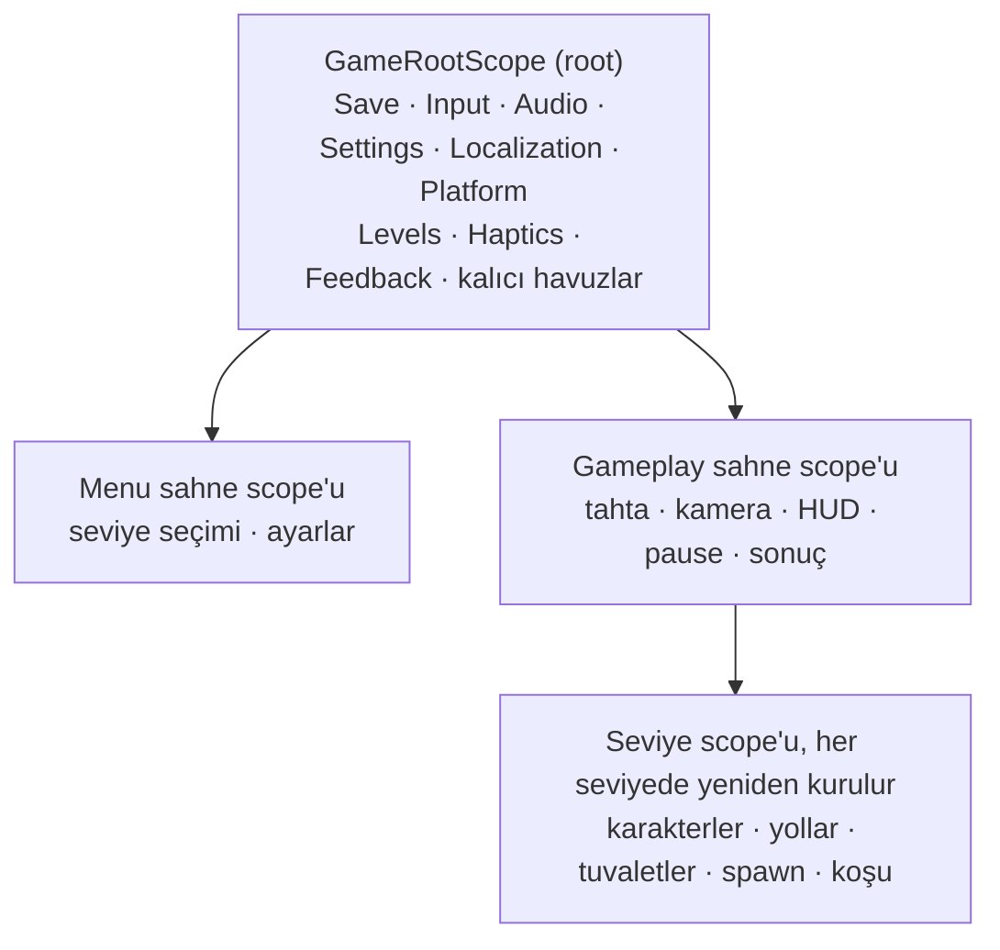
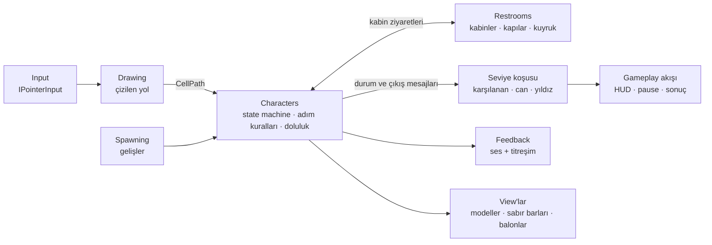

# HoldIt

[English](README.md)

*Yollarını çiz. Sırayı gözet. Kimse altına kaçırmasın.*

HoldIt, yukarıdan bakışlı, dikey ekranlı bir Android bulmaca oyunu. Tuvalet binasına durmadan erkekler ve kadınlar geliyor,
her birinin hiç durmadan dolan bir sabır barı var. Bir ziyaretçiden başlayarak parmağınla kare kare doğru kapıya yol
çiziyorsun. Yanlış kapı, ağır bir ziyaretçiye fazla dar bir geçit ya da birinin durduğu bir kare ziyaretçiyi olduğu yerde
durdurur. Bar dolunca kaza olur, üç kaza seviyeyi bitirir.

Portfolyo için yapılmış küçük ve bitmiş bir oyun: prototip değil, temiz kuralları, testleri ve altında bir framework'ü olan
gerçek bir Unity projesi.

## Nasıl oynanır

- **Yol çiz.** Bir ziyaretçiye bas ve tahtada sürükle. Yol kare kare uzar ve ziyaretçinin nerede durabileceğini gösterir;
  bırakınca ziyaretçi yolu yürür.
- **Kapılar cinsiyetlidir.** Kadınlar kapısına giden erkek konuşma balonuyla geri çevrilir ve olduğu yerde kalır; yeniden çiz.
- **Beden önemlidir.** İnce, Normal ve Şişman ziyaretçiler farklı hızlarda yürür; Şişman olanlar dar geçitlerden sığmaz.
- **Kabinler dolar.** Ziyaretçi boş bir kabini alır ve lamba kırmızıya döner. Hepsi doluysa kapıda bekler ve o kareyi tıkar;
  sıradaki ziyaretçiyi onun etrafından dolaştırman gerekir.
- **Sabır biter.** Her başın üstündeki bar yeşilden kırmızıya döner ve ziyaretçi titremeye başlar. Kaza bir su birikintisi
  bırakır ve üç canından birini götürür.
- **Yıldız**, son ziyaretçi karşılandığında ya da kaybedildiğinde kalan canındır. 30 seviye var, her birinin kendi haritası.

## Ekran görüntüleri

*Ana menü, seviye seçimi, oynanmakta bir seviye, sonuç ekranı ve ayarlar (İngilizce arayüzle).*

## İndirme

Android APK'sı (Android 7.1 ve üstü, ARM64), bir sürüm yayımlandığında projenin
[GitHub Releases](https://github.com/ramazantoy/HoldIt/releases) sayfasına eklenir. Debug anahtarıyla imzalı; bilinmeyen
kaynaklardan kurulumu açarak kurulur, Play Protect bilinmeyen geliştirici uyarısı verebilir. Oyun hiçbir mağazada değil.
APK depoda tutulmaz; 0.1.0 sürümünün Release build'idir ve kaynaktan yeniden derlenebilir (aşağıya bak).

## Durum

İlk seviyeden sonuncuya kadar oynanabilir; İngilizce ve Türkçe, ses, müzik ve titreşimle (titreşim Ayarlar'dan kapatılır).
Henüz pürüzlü olanlar, kimse kendi bulmak zorunda kalmasın diye:

- Karakterler geçici basit şekiller (altı varyant: erkek ve kadın, ince, normal ve şişman). Gerçek modeller henüz yok, ortam
  kitinin son kabin parçaları da yok.
- Tek bir Android telefonda oynandı. Başka cihazlar, titreşim güçleri ve animasyonların telefondaki hissi hâlâ bakılacak.
- Zorluk eğrisi, gerçek oyunla değil referans oyunculu bir simülasyonla ayarlandı.

## Nasıl yapıldı

Unity 6000.3.27f2 (6.3 LTS), Universal Render Pipeline, özel bir toon shader ve Blender'da modellenmiş bir ortam kiti. Kodda
VContainer, MessagePipe, UniTask, PrimeTween ve Input System var.

Kurallar mümkün olduğunca Unity tipi olmayan saf C#: grid, çizilen yol, karakterlerin state machine'i, kabinler ve kuyruk,
sabır, spawn ve koşunun kendisi. MonoBehaviour'lar yalnızca bunları çizer. Her kural sınıfının EditMode testi var (yalnız
oyun assembly'sinde 650'den fazla) ve her yeni test dosyası, kodu bir kez bilerek bozup testin kırıldığı görülerek kontrol
edildi. Oynanış kodu input'u yalnız `IPointerInput` üzerinden tanır; özellikler birbirine küçük arayüzler ve MessagePipe
mesajlarıyla ulaşır.

Seviyeler `ScriptableObject`; her birinin kendi haritası var. Editor'daki bir üretici ve bir harita aracı 30 seviyeyi
üretiyor, referans oyunculu bir simülasyon kaç ziyaretçinin ne hızla geleceğini ayarlıyor. Ayarlanabilir her sayı config
asset'lerinde duruyor.

Altında `Assets/Framework/` var: küçük bir framework (scope'lar, oyun durumları, sahne yükleme, kayıt, input modları, ses,
havuzlar, ayarlar, yerelleştirme, platform servisleri ve kontrollü bir build hattı). Modül modül
[`Assets/Framework/Documentation~`](Assets/Framework/Documentation~/Core.md) altında belgelendi (İngilizce).

## Proje düzeni

| Yol | İçinde ne var |
|---|---|
| `Assets/Game/` | Oyun: `Game` assembly'si, `HoldIt` namespace'i, özellik başına bir klasör (`Board`, `Paths`, `Characters`, `Restrooms`, `Spawning`, `Levels`, `Gameplay`, `UI`, ...) |
| `Assets/Game/Tests/` | Kural sınıflarının EditMode testleri (`Game.Tests`) |
| `Assets/Framework/` | Framework (`AF.*`), kendi testleri ve [dokümanı](Assets/Framework/Documentation~/Core.md) ile |
| `.claude/` | Karar kaydı (`decisions/`, alan başına bir dosya) ve işin izlediği kurallar |
| `CLAUDE.md` | Bu projede Claude Code'un çalışma kuralları |

## Kaynaktan derleme

1. Projeyi Unity **6000.3.27f2** ile aç ve OpenUPM paketleri için eksik imza diyaloğunu kabul et.
2. Android için Android Build Support'u (SDK, NDK, OpenJDK) kur ve platformu **File > Build Profiles**'tan değiştir.
3. Testleri **Window > General > Test Runner**'dan (EditMode), kontrolleri **AF > Validate All** ile çalıştır.
4. **AF > Build > Release** aktif platformu `Builds/<Platform>/Release/` altına derler; bir kontrol başarısızsa derlemez.

## Katkılar ve lisanslar

Kod [MIT lisansı](LICENSE) altında. Üçüncü taraf asset ve paketler kendi lisanslarını korur; her asset klasöründe lisans metni dosyaların
yanında durur.

| Asset | Yazar ve kaynak | Lisans |
|---|---|---|
| Arayüz sesleri | [Interface Sounds](https://kenney.nl/assets/interface-sounds), Kenney | CC0 |
| Seviye kazanma ve kaybetme jingle'ları | [Music Jingles](https://kenney.nl/assets/music-jingles), Kenney | CC0 |
| Kapı vuruşu, kapı, sifon ve su sesleri | ["100 CC0 SFX"](https://opengameart.org/content/100-cc0-sfx), OpenGameArt | CC0 |
| Menü müziği | ["Jump"](https://opengameart.org/content/jump), ThePixel, OpenGameArt | CC0 |
| Oyun müziği | ["Free Fall"](https://opengameart.org/content/free-fall), Tad, OpenGameArt | CC0 |
| Baloo 2 fontu | [The Baloo 2 Project Authors](https://github.com/EkType/Baloo2) | SIL OFL 1.1 (`Assets/Game/UI/Fonts/OFL.txt`) |
| Liberation Sans fontu (TextMesh Pro varsayılanı) | Red Hat, Inc.; sayısallaştırılmış veri Google | SIL OFL 1.1 |
| Ortam kiti, UI sprite'ları, karakterler, açılış videosu | Kendi işim | Kod gibi MIT |
| Ekran görüntüleri ve GIF'ler | Yazar tarafından çalışan oyundan, Unity Editor'da kaydedildi; GIF'ler iki kat hızda oynar | Kendi işim, kod gibi MIT; içlerindeki font ve görseller yukarıdaki lisansları korur |
| VContainer, UniTask, MessagePipe | [hadashiA](https://github.com/hadashiA/VContainer) ve [Cysharp](https://github.com/Cysharp) | MIT |
| PrimeTween | [Kyrylo Kuzyk](https://github.com/KyryloKuzyk/PrimeTween) | PrimeTween lisansı; şartları gereği npm'den kurulur, bu depoya kopyalanmaz |
| Input System, Localization, URP ve diğer Unity paketleri; Newtonsoft Json | Unity Technologies; James Newton-King | Unity paket şartları (Package Manager ile kurulur); MIT |

## Yazarlık

Mimari, kararlar ve inceleme Ramazan Toy'a ait. Kodun büyük kısmı bu yönlendirme altında Claude Code ile yazıldı; o
commit'lerde Co-Authored-By satırı var. `CLAUDE.md` ve `.claude/`, işin izlediği kuralları ve karar kaydını tutar.
